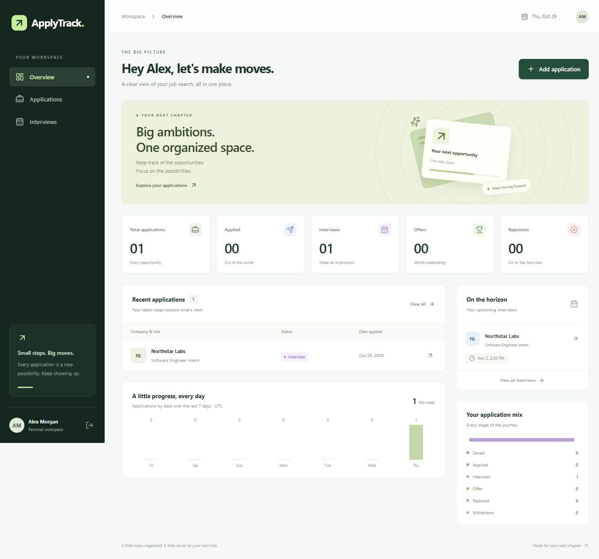

# ApplyTrack — Internship & Job Application Tracker

A full-stack MERN application that brings a job search into one calm, organized workspace. Built with React, Vite, Tailwind CSS, Express, MongoDB, and secure JWT authentication.



See [verification results](docs/VERIFICATION.md) for the original local build, integration tests, and desktop/mobile browser checks. The test suite also covers the Vercel adapter and connection lifecycle.

## Features

- Registration, login, session restoration, protected routes, and logout.
- Dashboard with total applications, current Applied / Interview / Offer / Rejected counts, recent applications, a seven-day activity chart, status distribution, and upcoming interviews.
- Create, read, edit, and delete applications. Track company, role, job type, location, URL, salary/stipend, application date, interview time, status, and notes.
- Six statuses: **Saved, Applied, Interview, Offer, Rejected, Withdrawn**.
- Search by company or title, filter by status, sort by application date, and paginate results.
- Change status directly from the applications table. Dedicated interview view includes past, upcoming, and unscheduled interviews.
- Responsive sidebar, mobile navigation, keyboard focus styles, loading/empty/error states, toast feedback, and a native confirmation dialog for deletion.
- Every database query is scoped to the authenticated user.

## Requirements

- **Node.js 24 LTS** and npm. The root package pins `24.x` for local and Vercel builds.
- For your own database: MongoDB Community or a MongoDB Atlas connection string.
- Alternatively, the included local development launcher runs a real MongoDB binary for you. It reuses a standard Windows MongoDB installation when available, otherwise downloads the official binary. Downloads require internet and a platform supported by MongoDB (including 64-bit Windows). Docker is not required.

## Quick start: no database account required

Run these commands from the `ApplyTrack` directory:

```powershell
npm install
npm run setup
npm run dev:local
```

Open **http://127.0.0.1:5173** and create your account. The app intentionally starts empty; there are no hardcoded credentials or fake dashboard records.

- `setup` creates `server/.env` with a cryptographically random JWT secret, and never overwrites an existing configuration.
- `dev:local` also runs setup automatically. It reuses an installed Windows MongoDB executable or downloads MongoDB into `.cache/mongodb`, starts an isolated instance on loopback port `27018`, and runs both the API and frontend. Local records persist in `.local-data/mongodb` across restarts. Existing MongoDB services/data are not used or modified. On any platform, set `MONGOMS_SYSTEM_BINARY` to an existing `mongod` executable to reuse it.
- The launcher overrides `MONGODB_URI` only for its child server process; it does not rewrite your configured database URL.
- Keep only one `dev:local` process running at a time. Press **Ctrl+C** in its terminal to stop the development services.
- These local database/cache directories are ignored by Git. They are development conveniences, not a production database or backup strategy.

## Use MongoDB Community or Atlas

```powershell
npm install
npm run setup
```

Edit `server/.env`. Set `MONGODB_URI` to your database connection string. The default is:

```dotenv
MONGODB_URI=mongodb://127.0.0.1:27017/applytrack
```

Start your local MongoDB service, or configure your Atlas database user and network access. For Atlas, use its provided connection string and URL-encode any special characters in the database password. Keep credentials out of source control.

```powershell
npm run dev
```

Frontend: **http://127.0.0.1:5173**. API: **http://127.0.0.1:5000/api**.

## Environment variables

Templates: [`server/.env.example`](server/.env.example) and [`client/.env.example`](client/.env.example).

| Variable | Location | Purpose |
| --- | --- | --- |
| `MONGODB_URI` | `server/.env` | **Required for normal dev/start.** Your MongoDB connection string. `dev:local` supplies its own URI. |
| `JWT_SECRET` | `server/.env` | **Required.** Unique random secret of at least 32 characters. `npm run setup` generates one. Never share or commit it. |
| `PORT` | `server/.env` | API port, default `5000`. Update the Vite proxy if changing it. |
| `HOST` | `server/.env` | Listen address, default `127.0.0.1`. Use `0.0.0.0` if required by your container host. |
| `CLIENT_URL` | `server/.env` | Exact trusted browser origin, default `http://127.0.0.1:5173` locally. An explicit HTTPS origin is required in production. Used for CORS and CSRF protection. |
| `NODE_ENV` | `server/.env` | `development` locally; `production` for HTTPS deployment and serving the built frontend. |
| `TRUST_PROXY` | `server/.env` | Default `0`. Set `1` only behind exactly one trusted reverse proxy. |
| `VITE_API_URL` | `client/.env` | Optional, defaults to `/api`. No client `.env` is required for local or same-origin hosting. Never place secrets in Vite variables. |

Use `127.0.0.1` consistently during development. `localhost` is a different origin; if you prefer it, update `CLIENT_URL` accordingly and use it consistently. Browser mutation requests from other origins are rejected.

## Commands

| Command (from root) | Action |
| --- | --- |
| `npm install` | Install all workspace dependencies. |
| `npm ci` | Reproduce the committed lockfile installation. |
| `npm run setup` | Generate a local server configuration and secret. |
| `npm run dev` | Run Express with watch mode and Vite together. Requires your configured MongoDB. |
| `npm run dev:local` | Run frontend, backend, and a persistent local development MongoDB. |
| `npm run build` | Produce `client/dist`. |
| `npm test` | Build the frontend, then run API integration tests against an isolated real MongoDB process. |
| `npm run start` | Start Express using `server/.env`. In production mode it also serves `client/dist`. |
| `npm run dev -w client` | Start only Vite. |
| `npm run dev -w server` | Start only Express. |

The first integration test run may download a MongoDB binary. Tests use an isolated temporary database and do not touch development accounts or applications. Binary downloads are cached inside this repository. The production serving test requires `client/dist`; the root test script builds it automatically.

## Deploy to Vercel with MongoDB Atlas

Deploy the repository as **one Vercel project**: Vercel serves `client/dist` from its CDN and runs the Express API as a Node.js function at `/api/*`. MongoDB stays in Atlas. No Next.js migration, separate backend provider, paid domain, or running local MongoDB is required.

### Build settings

Import the repository into Vercel using these settings. The checked-in `vercel.json` supplies the install/build/output settings; keep the project root at the repository root so npm can install both workspaces from the root lockfile.

| Setting | Value |
| --- | --- |
| Root Directory | Repository root (`.`), **not** `client` or `server` |
| Framework Preset | Other (`framework: null`) |
| Install Command | `npm ci` |
| Build Command | `npm run build` |
| Output Directory | `client/dist` |
| Node.js Version | `24.x` (also pinned in `package.json`) |
| Start Command | None; Vercel invokes `api/index.js` |
| Function duration | 30 seconds, configured in `vercel.json` |
| Function region | Choose one near the Atlas cluster in Vercel project settings |

Do not use `npm start`, `npm run setup`, `npm run dev:local`, or `npm test` as the Vercel build command. Tests launch an isolated local MongoDB binary and belong in local verification/CI.

### Production environment variables

Add these in **Vercel → Project → Settings → Environment Variables**, scoped to Production. They are not copied from `server/.env`; that file is excluded from Git and Vercel uploads/function bundles. Vercel uses platform variables, while local development continues to load `server/.env`.

| Name | Value |
| --- | --- |
| `MONGODB_URI` | Atlas connection URI for the `applytrack` database, including the database user's credentials |
| `JWT_SECRET` | A fresh cryptographically random secret of at least 32 characters; keep the same value across instances |
| `NODE_ENV` | `production` |
| `CLIENT_URL` | Your exact HTTPS browser origin, for example `https://your-project.vercel.app`; no `/api`, query, or fragment |
| `TRUST_PROXY` | `1` for direct hosting behind Vercel; verify forwarded client IPs after deployment |
| `NODEJS_HELPERS` | `0`, so Express owns request parsing and enforces its 32 KB JSON body limit |
| `VITE_API_URL` | `/api`, or leave unset to use that default |

`PORT` and `HOST` are not needed by the function. Never expose `MONGODB_URI` or `JWT_SECRET` through a `VITE_` variable. Generate a production secret with a password manager/secure generator and paste it directly into Vercel. Do not put it in source code. Environment changes require a new deployment; Vite variables are embedded at build time.

In Vercel's value field, paste **only the URI**, beginning `mongodb+srv://` (or the standard `mongodb://` form supplied by Atlas). Do not include `MONGODB_URI=` in the value. Locally the format is one assignment:

```dotenv
MONGODB_URI=mongodb+srv://<database-user>:<url-encoded-password>@<cluster-host>/applytrack?retryWrites=true&w=majority
```

Use the real URI from Atlas **Connect → Drivers** and URL-encode special characters in the password. The application rejects a duplicated assignment prefix without printing the credentials.

### Atlas and deployment steps

1. Use an Atlas **Free** cluster and a database user with `readWrite` access to `applytrack`. An Atlas website login is not a database user. Verify the cluster is running and the connection string targets the correct database.
2. Configure Atlas Network Access for Vercel's outbound connections. Standard Vercel hosting uses dynamic egress IPs; Atlas documents allowing `0.0.0.0/0` for this integration. This opens network reachability, so use strong, unique database credentials and limited database permissions. IP-restricted/private connectivity requires a different networking arrangement. Keep the app and database regions close.
3. On Node 24, run `npm ci` and `npm test` locally. Keep `.env`, `.cache`, `.local-data`, and `node_modules` out of source control. This folder must be placed in a Git repository before using Git-based deployment; a Vercel CLI deployment from the repository root is an alternative.
4. Create/import a Vercel project using the build settings above. Set the Production variables and the exact domain you intend to use. The free `vercel.app` domain is sufficient. If Vercel assigns a different domain, update `CLIENT_URL` and redeploy before testing authentication.
5. Deploy when ready. No deployment is performed by the project's scripts. Keep Vercel's default HTTPS behavior enabled.
6. Verify `/api/health` returns JSON with `status: ok`. On the Vercel adapter, this waits for a database connection; it is not merely a process-alive check. Verify `/api/unknown` returns JSON 404, not the React page.
7. In a browser, register, log in, reload, create/edit/delete an application, and log out. Verify refreshes of `/applications`, `/interviews`, and `/applications/new` load the SPA; JS/CSS assets must return their correct content types. Verify cookies have `HttpOnly`, `Secure`, and `SameSite=Lax`, and mutations from other origins return 403. Confirm forwarding identifies distinct clients correctly for rate limiting.

### Routing, authentication, and previews

`vercel.json` routes `/api` and `/api/*` to the API entry point before the SPA fallback. Existing static files are served directly; other frontend paths fall back to `/index.html` for React Router. API requests keep their original path and query string. The API rewrite deliberately uses an unnamed `(.*)` capture: Vercel can append unused named captures as query parameters, which would violate the API's strict query validation. The function disables Express frontend serving, while `npm start` retains it for conventional hosting. CDN security headers preserve the protections formerly applied by Helmet to frontend responses. API responses remain `Cache-Control: no-store`.

The API reuses one Express app and a small MongoDB pool per warm function instance. Concurrent initialization shares one promise, rejected attempts can retry, and requests do not disconnect the pool. Pools use at most five application connections each and retire idle connections after 60 seconds. Different instances still have separate pools. Existing JWT verification, database-backed logout revocation, ownership checks, request validation, CORS, CSRF, and rate limits remain enabled.

Keep browser requests on the frontend origin with `VITE_API_URL=/api`. Do not replace this with an unrelated backend domain: the current SameSite=Lax cookies are intentionally designed for same-site requests. `CLIENT_URL` is an exact origin, not a wildcard; the app never trusts a request's Host header to authorize mutations.

For Preview deployments, set the same required variables under the **Preview** environment, with a separate database/secret and an explicit stable preview origin. A branch-specific preview domain and branch-scoped `CLIENT_URL` override are useful. Open that configured origin; arbitrary generated preview URLs will correctly fail mutation requests with 403. Do not use `*` or broadly allow all `vercel.app` hosts. Changing the production domain similarly requires updating `CLIENT_URL` and redeploying.

### Free-tier scope and remaining limitations

- Vercel Hobby is for personal, non-commercial projects and is subject to usage caps. This small CRUD app needs no paid Vercel features. Check usage after launch, especially CPU from bcrypt and memory time from database waits.
- Atlas Free has storage, throughput, and connection limits and can pause after inactivity. Keep connection pools small and monitor usage. Local `.local-data` records are not automatically migrated to Atlas.
- The existing rate limiters use process memory. Their counters are not shared across Vercel instances and reset on cold starts. They remain enabled, but reliable distributed throttling requires a shared rate-limit store before treating them as a global abuse-control guarantee.
- Cold starts, Atlas network access, production browser behavior, and Vercel's actual routing/bundling must be checked on the first deployment. Local tests cannot certify the hosted platform configuration.

Official references: [Node.js versions](https://vercel.com/docs/functions/runtimes/node-js/node-js-versions), [Node functions and disabling helpers](https://vercel.com/docs/functions/runtimes/node-js/advanced-node-configuration), [Vite SPA routing](https://vercel.com/docs/frameworks/frontend/vite#using-vite-to-make-spas), [Hobby plan](https://vercel.com/docs/plans/hobby), [Atlas–Vercel network access](https://www.mongodb.com/docs/atlas/reference/partner-integrations/vercel/), and [Atlas Free limits](https://www.mongodb.com/docs/atlas/reference/free-shared-limitations/).

## Production on a conventional Node host

1. Install dependencies and run `npm run build`.
2. Set `NODE_ENV=production`, a production `MONGODB_URI`, a fresh `JWT_SECRET`, and `CLIENT_URL=https://your-domain.example` in the server environment.
3. Run `npm start` behind an HTTPS reverse proxy that forwards to `127.0.0.1:5000`. Express serves the React build and `/api` from the same origin. Keep the Node process managed by your hosting platform/process manager.
4. Configure `TRUST_PROXY` to match your actual trusted proxy chain so rate limiting uses the correct client address.

The default server binds to loopback, making it suitable behind a reverse proxy. If your container host requires it, set `HOST=0.0.0.0` in the server environment. HTTPS is required for production session cookies. For a simple portfolio deployment, same-origin hosting avoids cross-site cookie restrictions. `vite preview` is a build-preview server, not the full production backend.

## Project structure

```text
ApplyTrack/
├── api/index.js            # Vercel Node function entry point
├── vercel.json             # API rewrites, SPA output, security headers
├── client/
│   ├── public/favicon.svg
│   ├── src/
│   │   ├── components/       # Layout, table, reusable UI
│   │   ├── context/          # Authentication and toast state
│   │   ├── hooks/            # Fetch/retry/abort and debounced search
│   │   ├── lib/              # API client and date/status helpers
│   │   ├── pages/            # Authentication, dashboard, CRUD screens
│   │   ├── App.jsx
│   │   └── styles.css        # Tailwind + responsive design styles
│   └── vite.config.js
├── server/
│   ├── src/
│   │   ├── controllers/      # Auth, application CRUD, dashboard
│   │   ├── middleware/       # JWT, CSRF origin guard, errors
│   │   ├── models/           # Mongoose User and Application
│   │   ├── routes/           # REST route definitions
│   │   ├── utils/            # Strict input validation and HTTP errors
│   │   ├── app.js            # Testable Express application factory
│   │   ├── config.js
│   │   ├── database.js      # Shared MongoDB connection/pool initialization
│   │   ├── serverless.js    # Cached API-only Express app for Vercel
│   │   └── index.js          # DB connection, startup, graceful shutdown
│   ├── test/api.test.js
│   └── .env.example
├── scripts/                 # Secure env setup and local MongoDB launcher
├── package.json             # npm workspaces and shared commands
└── README.md
```

## API reference

All routes use the `/api` prefix. Mutation requests must send an `Origin` header matching `CLIENT_URL`, including when testing with Postman or curl. Authentication uses the `applytrack_session` HTTP-only cookie; enable cookie persistence in your API client. Responses are JSON except successful logout/delete (`204`).

| Method | Endpoint | Authentication | Behavior |
| --- | --- | --- | --- |
| GET | `/health` | Public | Process health check. |
| POST | `/auth/register` | Public | `{ name, email, password }`, creates account and session. |
| POST | `/auth/login` | Public | `{ email, password }`, creates session. |
| GET | `/auth/me` | Required | Current user's public profile. |
| POST | `/auth/logout` | Required | Clears cookie and revokes all existing sessions for this account. |
| GET | `/applications` | Required | Paginated application list. |
| POST | `/applications` | Required | Create application. |
| GET | `/applications/:id` | Required | Fetch an owned application. |
| PATCH | `/applications/:id` | Required | Update one or more allowed fields. |
| DELETE | `/applications/:id` | Required | Permanently delete an owned application. |
| GET | `/dashboard` | Required | Counts, recent records, upcoming interviews and activity. |

List query parameters: `search`, `status`, `sort=newest|oldest`, `page` (default 1), `limit` (default 8, maximum 100). Example: `/api/applications?search=frontend&status=Applied&sort=newest&page=1`.

Example application body:

```json
{
  "company": "Example Company",
  "jobTitle": "Frontend Developer Intern",
  "jobType": "Internship",
  "location": "Remote",
  "applicationUrl": "https://example.com/careers",
  "salary": "₹25,000/month",
  "applicationDate": "2026-10-29",
  "interviewDate": null,
  "status": "Applied",
  "notes": "Prepare a walkthrough of ApplyTrack."
}
```

`company`, `jobTitle`, and `applicationDate` are required when creating a record. Job type is `Internship`, `Full-time`, `Part-time`, or `Contract`. `applicationDate` is a calendar date (`YYYY-MM-DD`) stored at UTC midnight so it does not shift across timezones. `interviewDate` is an ISO timestamp with timezone or `null`; the UI converts local input to UTC and displays it in the viewer's timezone. Salary is free text to accommodate different currencies and pay periods.

Dashboard counts reflect **current statuses**, not historical stages. The activity chart uses application dates over the last seven UTC calendar days, excludes Saved records, and is not an audit log. Upcoming interviews require both Interview status and a future interview time. Changing status preserves the interview date and notes.

## Security and implementation choices

- bcrypt hashes with cost 12; passwords require 8 characters and at most 72 UTF-8 bytes (bcrypt's input limit).
- Signed HS256 JWTs with issuer, audience, and seven-day expiry. Stored in HTTP-only, SameSite=Lax cookies; Secure in production. Tokens are never stored in browser localStorage.
- An account token version revokes all previously issued JWTs on logout, including copied tokens.
- Every read, update, delete and dashboard query includes the authenticated user ID. A record belonging to someone else returns 404.
- Strict Zod schemas reject unknown fields, operator objects, invalid dates/statuses, oversized strings, and non-HTTP(S) application URLs. Search escapes regex metacharacters. React renders notes as text.
- Exact origin checks protect cookie-authenticated mutations against CSRF. Helmet provides security headers, request bodies are limited, and API/auth routes are rate limited.
- Password hashes and token versions are omitted from API responses. Centralized error handling does not send stack traces or database errors to clients.
- This intentionally small project has no password-reset email flow, social login, uploads, payments, or external integrations. Rate limiting uses process memory; a multi-instance production deployment should use a shared store.

## Verification

`npm test` covers registration, login, cookie settings, password hashing, create/read/update/delete, every status, search/filter/sort/pagination, upcoming interviews, validation, ownership isolation, CSRF rejection, logout token revocation, rate limiting, and serving the built frontend in production mode. Tests run against real MongoDB, not mocked Mongoose calls.

For a manual UI check:

1. Register and confirm the empty dashboard.
2. Add an application with all fields and confirm it appears in the table.
3. Edit the role and notes, set an interview time, and change its status to Interview.
4. Confirm the dashboard counts and upcoming interview; search/filter/sort the table.
5. Delete it through the confirmation dialog.
6. Sign out and sign in again. Register a second account and confirm it has an independent workspace.

## Troubleshooting

- **Cannot connect to MongoDB:** start your database service, check Atlas network access/credentials, or use `npm run dev:local`.
- **Request origin is not allowed:** open the exact origin configured in `CLIENT_URL`, including hostname and port.
- **Address already in use:** stop the previous ApplyTrack terminal session. The local launcher uses ports 5173, 5000, and 27018.
- **Local MongoDB download fails:** allow the MongoDB download host through your network/firewall, or use your own MongoDB via `npm run dev`.
- **Session does not persist:** use consistent hostnames and enable cookies. Production mode requires HTTPS.
- **Server unreachable in browser:** confirm both API and Vite are running. Vite forwards `/api` requests to port 5000.
- **Production page missing:** run `npm run build` first, then start with `NODE_ENV=production` and a reachable database.

## Portfolio talking point

“Built ApplyTrack, a full-stack MERN application with JWT authentication, user-scoped CRUD APIs, MongoDB aggregation dashboards, responsive React UI, and automated integration tests for security and core workflows.”

Useful official references: [Vite](https://vite.dev/guide/), [Tailwind's Vite integration](https://tailwindcss.com/docs/installation/using-vite), and [Express security practices](https://expressjs.com/en/advanced/best-practice-security.html).
